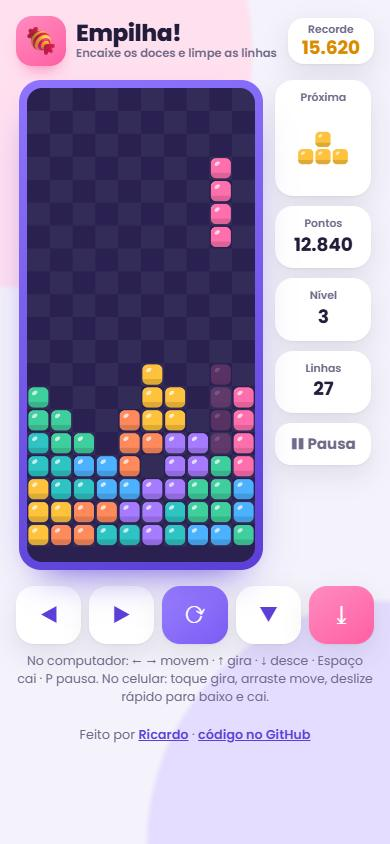
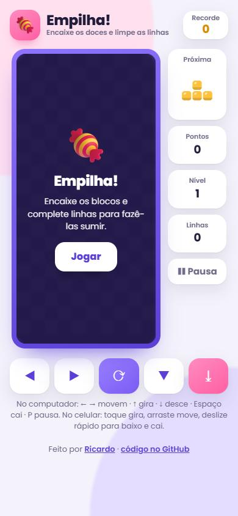

# 🍬 Empilha!

**Encaixe os doces que caem e complete linhas para fazê-las sumir.**

&nbsp;&nbsp;

## Como jogar

| Ação | Computador | Celular |
|---|---|---|
| Mover | ← → | arrastar para o lado ou ◀ ▶ |
| Girar | ↑ ou X | tocar no tabuleiro ou ⟳ |
| Descer mais rápido | ↓ | arrastar para baixo ou ▼ |
| Cair de uma vez | Espaço | deslizar rápido para baixo ou ⤓ |
| Pausar | P | botão Pausa |

- Linha completa some e dá pontos: **100** por 1 linha, **300** por 2, **500** por 3 e **800** por 4, multiplicados pelo nível.
- A cada **10 linhas** o nível sobe e os doces caem mais rápido.
- A peça "fantasma" mostra onde o doce vai cair. O quadro **Próxima** mostra o que vem depois.
- Seu **recorde** fica salvo no navegador.

## Detalhes

- Um único arquivo (`index.html`), com HTML, CSS e JavaScript puros, desenhado em Canvas.
- As peças saem de um "saco" com as 7 formas embaralhadas, para nenhuma sumir por muito tempo.
- Girar encostado na parede empurra a peça para caber, quando dá.
- Se você trocar de aba, o jogo pausa sozinho.
- Ícones: [Fluent Emoji 3D](https://github.com/microsoft/fluentui-emoji), da Microsoft (licença MIT).
